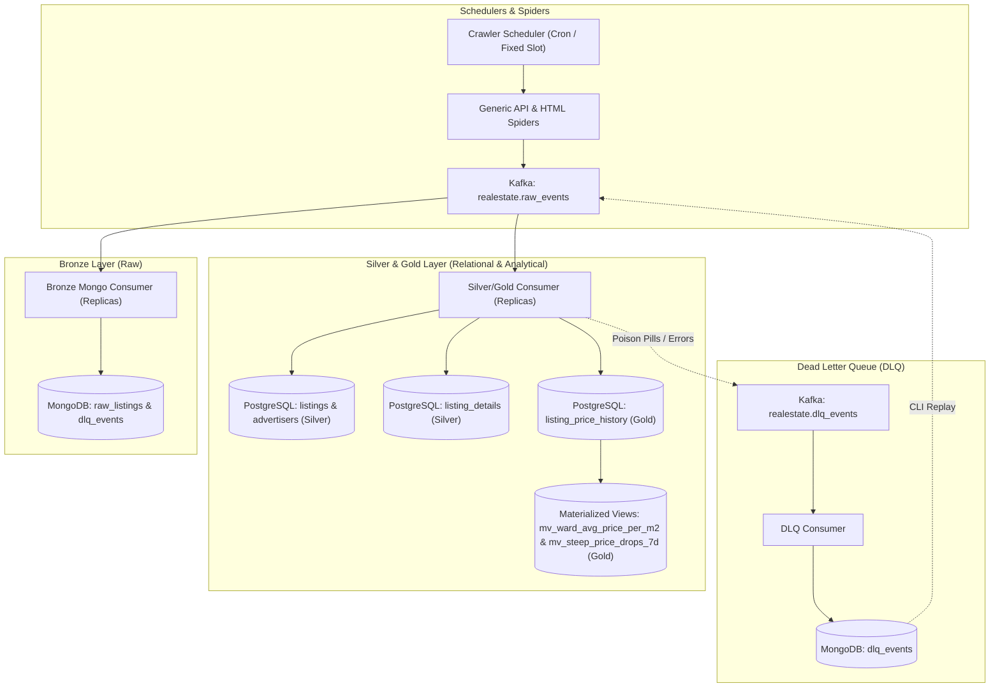

# System Architecture: Real Estate Price Tracking

## 1. Overview & High-Level Design

The **Real Estate Price Tracking System** is an event-driven, production-grade distributed crawling and analytical platform designed to track real estate listings, detect price changes, deduplicate properties, and compute market aggregates across Vietnam.

The system follows **Clean Hexagonal Architecture** and the **Medallion Architecture** pattern (Bronze, Silver, Gold data layers) with Apache Kafka acting as the asynchronous event backbone.

---

## 2. Medallion Data Architecture

### Bronze Layer (MongoDB)
- **Purpose**: Immutable raw storage of scraped JSON payloads and HTML snippets.
- **Collections**:
  - `raw_listings`: Stores exact payload alongside `listing_key`, `site_id`, `crawl_run_id`, and `scraped_at`.
  - `dlq_events`: Stores unparseable poison pills or system failures with full stack trace and metadata for replay.
- **Guarantee**: Zero data loss even if downstream parsers change or schema migrations occur.

### Silver Layer (PostgreSQL - Cleaned & Structured)
- **Tables**:
  - `listings`: Normalized core listing metadata (price, area, status, fingerprint, last_seen_at).
  - `listing_details`: Rich descriptive attributes, geographical PostGIS points (`geom`), addresses, and media URLs.
  - `advertisers`: De-duplicated brokers and owners identified by unified phone/identity.
- **Deduplication**: Fingerprint algorithm normalizes compound addresses, coordinates, and physical parameters to detect duplicate ads across multiple portals.

### Gold Layer (PostgreSQL - Analytical & History)
- **Tables & Views**:
  - `listing_price_history`: Append-only chronological record of detected price changes with `price_diff_vnd`, `price_diff_percent`, and `price_status`.
  - `mv_ward_avg_price_per_m2`: Ward/commune level real-time median and average price per $m^2$ metrics.
  - `mv_steep_price_drops_7d`: Automated identification of properties with price drops $\ge 5\%$ over the past 7 days.

---

## 3. Component Breakdown

| Component | Responsibility | Scaling Pattern |
|:---|:---|:---|
| **Scheduler** | Reads site schedules from `configs/sites/*.yaml`, checks due runs, triggers `CrawlSiteUseCase` | Single coordinator / Leader |
| **Spiders** | Generic REST and HTML parsers streaming listing items through async HTTP | Partitioned by site / concurrent workers |
| **Bronze Worker** | Consumes from `realestate.raw_events` and bulk-upserts into MongoDB | Horizontally scalable (Kafka consumer group) |
| **Silver/Gold Worker** | Consumes events, evaluates price delta, inserts transactional silver/gold records | Horizontally scalable (Kafka consumer group) |
| **DLQ Worker & CLI** | Isolates malformed payloads, allows manual inspection and CLI replay | Idempotent on replay |

